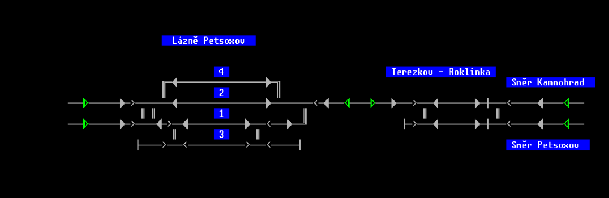

[ORMS](https://github.com/Petsox/Open-Rail-Management-System) Layout Generator Web Edition je webová aplikace pro tvorbu virtuálních kolejišť pro program [ORMS](https://github.com/Petsox/Open-Rail-Management-System) v modu [OpenComputers](https://github.com/MightyPirates/OpenComputers) do hry Minecraft.

## Verze 2

- **Editor kolejiště** s mřížkou 160 × 50 (přesně jako obrazovka ORMS), která kolejiště kreslí jako schéma: koleje, výhybky v obou polohách, návěstidla barevně podle druhu, popisky.
- **Nástroj Kolej**: trať se kreslí tažením myši, oblouky a výhybky (včetně hrotu) se doplní samy. Dále štětec a guma.
- **Paleta** se všemi symboly a prvky, názvy se číslují automaticky (Vy1, S1, PrS1, Se1, P1 …).
- **Panel Buňka**: vlastnosti vybraného prvku (poloha výhybky, invertovaná, druh a směr návěstidla, název), takže formát buňky není potřeba psát ručně.
- **Kontrola** běžící při každé změně: špatné formáty, výhybky bez hrotu, dvojí názvy, díry v kolejích, popisky v koleji, popisky, které v ORMS zakryjí sousední prvky, předvěsti bez hlavního návěstidla a další. Chybné buňky jsou v mřížce označené, klik na hlášení je ukáže.
- **Náhled OpenComputers**: obrazovka vykreslená stejně jako ORMS (barvy, umístění názvů, popisky, nadpis a tlačítka), se simulací přehazování výhybek a přejezdů.
- **Automatické centrování**: při exportu se kolejiště posune doprostřed obrazovky, nezůstane nalepené v rohu.
- Export do `config.lua` (stejný formát jako dřív), načtení `.lua` i `.csv` (i přetažením souboru), export stanice pro SignalCraft (EMZZ).
- Zpět/znovu pro všechny úpravy, kopírování a vkládání oblastí (kompatibilní s Excelem), vyplňování tažením za roh výběru, zoom, světlý i tmavý vzhled, průběžné ukládání v prohlížeči.

Aplikace nepoužívá žádné externí knihovny a nepotřebuje sestavení, stačí otevřít `index.html` přes webový server (např. GitHub Pages). Podrobný popis symbolů, formátů a pravidel je v [nápovědě](help.html).

[Zde je ORMS Layout Generator volně přístupný](https://petsox.github.io/ORMS-Layout-Generator-Web-Edition/)
